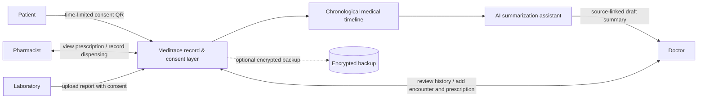
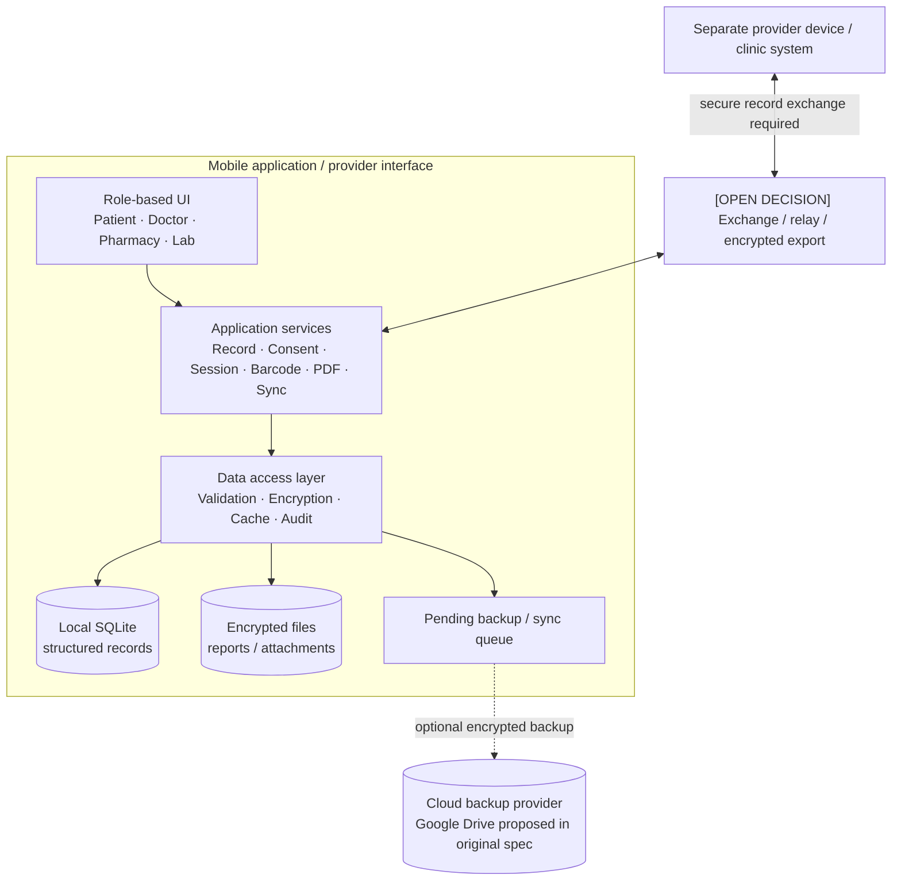
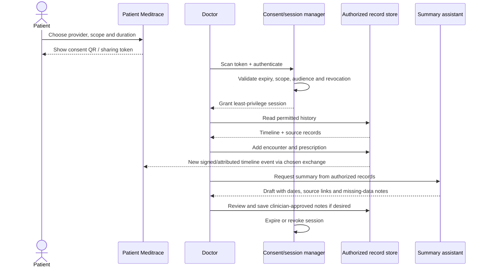
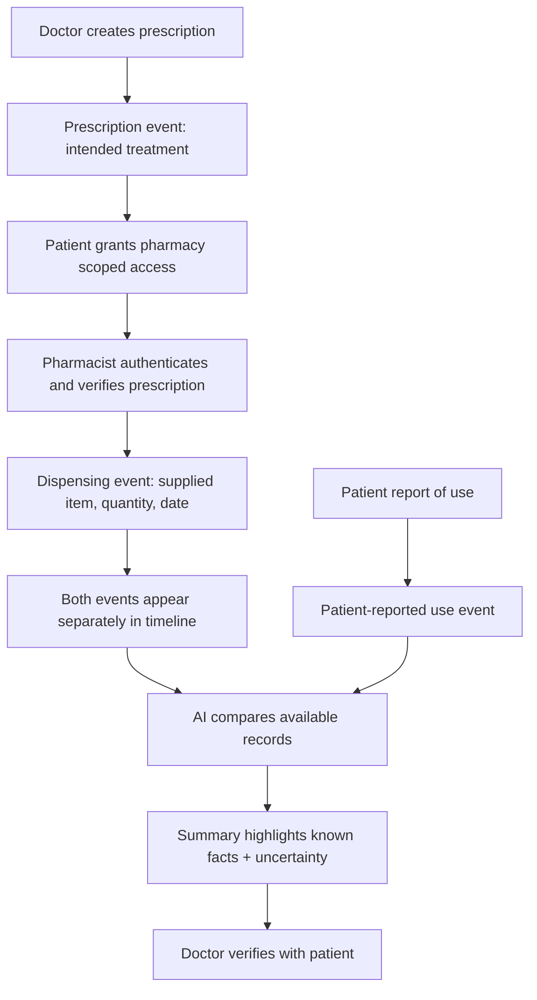
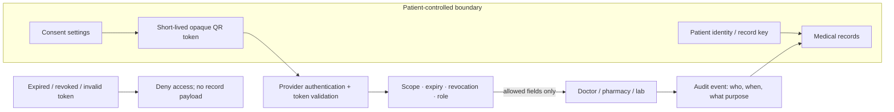
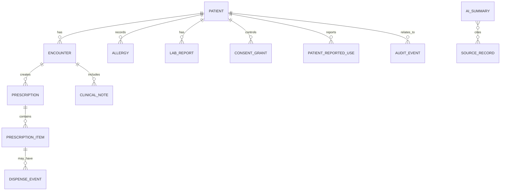
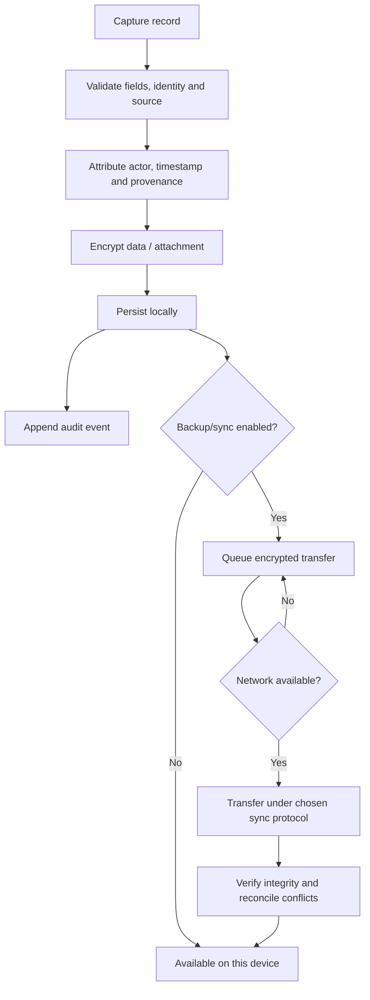
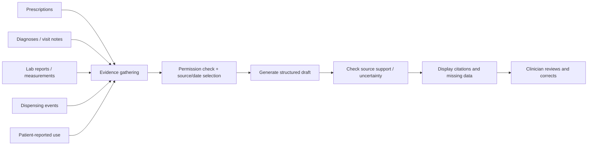

# Meditrace Architecture & Diagrams

**Status:** A synthesis of the existing offline-first specification and the broader product vision. Diagrams describe intended behavior, not a guarantee that every component has been implemented.

## 1. Product at a glance

## 2. Intended component architecture [EXISTING SPEC + PROPOSED]

**Important architecture tension:** The original specification says there is no central-server dependency and records are stored locally on the patient's device. But a doctor or pharmacy using another device cannot magically read or update that local database. Multi-device sharing requires a deliberate exchange design: encrypted export/import, a relay service, a synchronization service, or another reviewed approach. The product must decide how keys, revocation, offline changes, conflicts, and audit trails work. Do not promise seamless real-time sharing until this path exists and has been tested.

## 3. Consultation sequence

## 4. Pharmacy workflow and the three medication facts

- A **prescription** is not a purchase.
- A **dispensing record** is not proof of ingestion.
- Missing dispensing data is not proof of non-adherence.
- Patient-reported use is useful but must be labelled as self-reported.

## 5. Consent and trust boundaries

**Security rule:** The QR should not expose readable medical details. A QR scan alone must not grant unrestricted access; provider authentication and server/device-side validation are required. If fully offline validation is supported, revocation and expiry semantics need special attention.

## 6. Suggested conceptual data model

### Core entity definitions

| Entity | Key fields (illustrative) | Notes |
|---|---|---|
| Patient | patient_id, display_name, created_at | Use a stable internal ID; protect identity fields |
| Encounter | encounter_id, patient_id, clinician_id, occurred_at, status | Append-only clinical event preferred |
| Prescription | prescription_id, encounter_id, prescriber_id, issued_at, status | Not the same as dispensing |
| Prescription item | item_id, medicine_code/name, dose, route, frequency, duration, quantity | Preserve original instructions and amendments |
| Dispense event | dispense_id, item_id, pharmacy_id, dispensed_at, quantity, substitution, status | Supports partial fill and no-fill outcomes |
| Patient-reported use | report_id, item_id, reported_at, usage_description, source | Clearly mark as patient-reported |
| Lab report | report_id, patient_id, test_name, lab_name, collected_at, reported_at, file_ref | Store file encrypted; retain source |
| Consent grant | consent_id, patient_id, audience/provider, scope, issued_at, expires_at, revoked_at | Never trust client-only expiry checks |
| Audit event | event_id, actor_id, action, patient_id, timestamp, purpose | Avoid logging unnecessary medical payloads |
| AI summary | summary_id, created_at, model_version, source_ids, review_status | Draft versus clinician-approved must be clear |

This is a conceptual schema, not a migration or deployed database.

## 7. Data lifecycle

## 8. AI summary data flow

## 9. Technology candidates

**From existing design:** local SQLite, encrypted report files, QR consent/session management, barcode scanning, role-based interfaces, pending backup queue, optional encrypted Google Drive backup, AES-256-GCM and PBKDF2-SHA-256 named in the design. Cryptographic details must be reviewed before production; prefer platform-supported password/key derivation and secure key storage, and never implement cryptography casually.

**Broader options discussed:** Flutter or React Native for mobile; Node.js or Django for backend if a service is chosen; PostgreSQL or MongoDB for a centralized/shared data layer; medical NLP/LLM for summarization. These are alternatives to evaluate, not a selected final stack.

## 10. Diagrams are not implementation evidence

A component appearing in this file means it is part of the intended design. Check source code, tests, and deployment configuration before describing it as implemented. At the time this knowledge base was expanded, the repository tree contained the original requirements/design specs and documentation, but no verified production application source tree.
