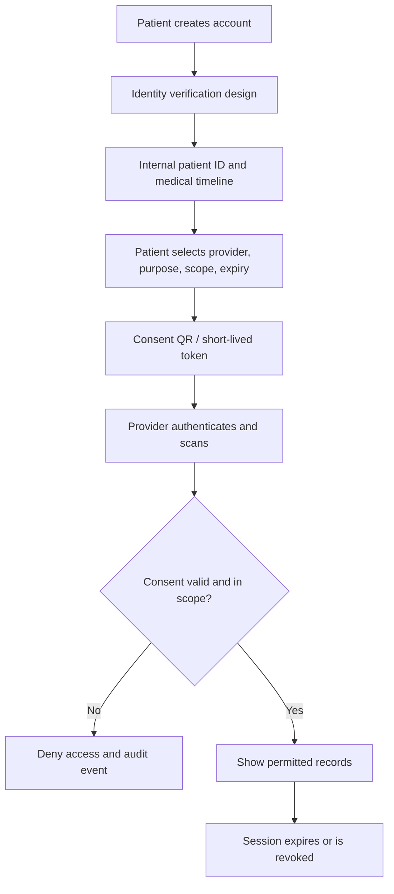
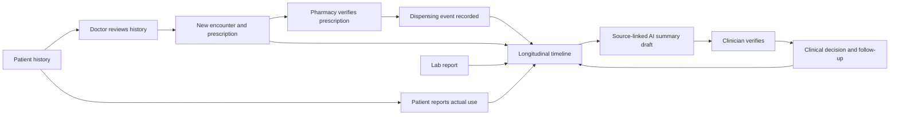
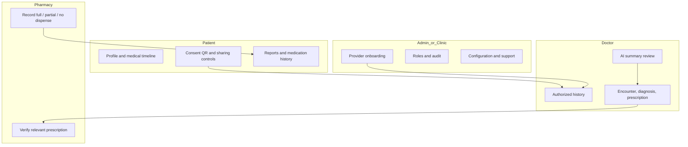
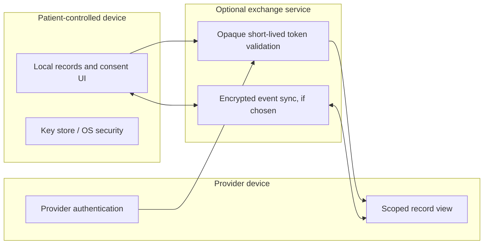

# Meditrace Diagrams and User Flows

These diagrams describe intended behavior, not proof of implementation. GitHub renders Mermaid in Markdown.

## Patient journey

## Care loop

## Four role views

## Trust boundaries

The exact data exchange architecture remains open. If the product must work across separate devices, “local-only” cannot mean no exchange mechanism exists. Define encryption/key ownership, recipient authentication, consent revocation, offline behavior, synchronization, conflict resolution, and auditability.

## AI summary example — safe wording
**Available records:** One encounter dated 12 October; one prescription for 10 units; one pharmacy event recording 4 units dispensed.

**Appropriate summary:** “A prescription for 10 units is recorded. A pharmacy dispensing event for 4 units is recorded. The available data does not establish whether the remaining quantity was obtained elsewhere or whether any medicine was taken.”

**Avoid:** “The patient was non-compliant” or “The patient did not take the medicine.” The records do not support those conclusions.
